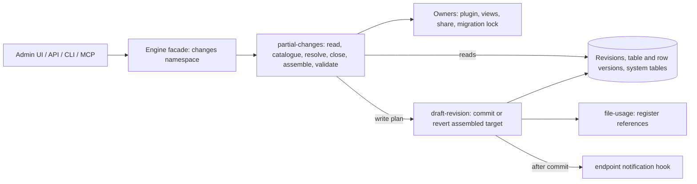

# ADR-001: Partial Commit and Revert of Draft Changes

## Status

Accepted (2026-10-31)

This ADR replaces [ADR-0021] of the Revisium architecture repository (granular revert, Proposed, never implemented).

## Date

2026-10-22

## Context

### Problem

A branch has one Head (the last commit) and one Draft (the working copy) ([ADR-0003]). The engine can only commit the
whole Draft (`createRevision`) or revert the whole Draft (`revertChanges`). People, programs and agents edit the same
Draft, so nobody can publish a finished part or undo one mistake without publishing or losing everyone else's work.

[REQ-001] defines the engine capability: [REQ-001.BR-003] (commit or revert a selected part, the rest stays),
[REQ-001.BR-004] (every result is consistent, a breaking selection is explained, a replica syncing through migration
export accepts every partial commit), [REQ-001.BR-005] (whole-Draft operations unchanged), [REQ-001.BR-007] (unit of
change: a field, a whole row for create and delete, all structure of a table with the values of its new or changed
fields), [REQ-001.BR-001] and [REQ-001.BR-009] (one engine primitive for every caller; sets, scheduling and UI are a
layer above). The SPEC (§2) maps each rule.

### Engine facts

A revision links table versions and a table version links row versions; committed versions are readonly and shared,
and a Draft edit copies the version it changes first. Schemas, the migration ledger, views and shared schemas are
rows of system tables in the same revision. Native row and schema writers run Serializable and take no row locks;
views writes and async-migration copy batches do not. Async migrations (tables of 1,000 rows or more, on by default
since v0.7.0, [ADR-0010]) record no migration and rewrite the schema and views rows in place: the Draft's own rows
when it has copied them, otherwise the rows shared with the Head and earlier revisions. Deployed projects may
therefore already hold a Head schema its ledger does not reproduce (and, until the next native commit, that its rows
do not match).

### Evidence

A five-milestone PoC proved the approach: 256 PostgreSQL scenarios through the real engine APIs, an `all: true`
oracle against native commit and revert, property tests (replica sync, unit-by-unit completeness, scoped plan equals
full plan), mutation controls (34 shown across M4–M5, 30 apply to the final code), and benchmarks at 10k–1M rows.
Two independent reviews accepted it with conditions; their findings are fixed in the PoC or decided in the SPEC.
Summary: [research/partial-changes-poc-v2.md](../research/partial-changes-poc-v2.md) (code:
`poc/partial-changes-assembly@c86e86c`, not published; an archive tag may be pushed on request). Measurements come
from a 2 CPU / 4 GB sandbox and show the cost shape, not SLAs.

## Decision

Partial commit and partial revert are an engine capability that **assembles the resulting revision from existing
immutable versions** (option A).

1. **Assemble from versions.** For each table the result links the Head version, the Draft version, or, only when a
   table mixes both sides, a new table version combining Head, Draft and new merged row versions. Formulas, hashes
   and file references are recomputed only for merged rows. A version linked by a committed revision is never changed.
2. **Revision transition as in native commit.** Commit: the current Draft revision becomes Head with the assembled
   content, a new child Draft gets every remaining edit, the previous Head loses `isHead`. Revert: the Draft keeps
   its id and is relinked. A table the operation read that keeps no unit links the Head version only if its content
   equals it; unread tables keep their Draft versions. After the transaction, endpoints are notified for every
   revision whose content changed (SPEC §6.13, §6.14).
3. **Unit model per [REQ-001.BR-007], complete.** Field, row (create, delete, replace, rename, row columns), structure
   (one per table), views and shared schema units; every Draft difference a native read exposes belongs to exactly
   one unit, and a test classifies every row and table column so a new native column cannot be missed (SPEC §3).
   Callers address units by public ids and JSON Pointer paths.
4. **Dependency closure in one call, with exact selectors.** Every operation computes all required additions with a
   reason, each with an exact selector, and names the unit to remove in a blocker. The caller adds them, or passes
   `includeRequired` with the reviewed `expected` fingerprint; excluding a required unit blocks. No operation writes a
   dangling reference, a duplicate id or an unreplayable ledger, with one exception: exactly `{ all: true }` on an
   unrepaired table the Head already damaged publishes it as native commit does, which no replica can reproduce (SPEC
   §5, §6.6, §6.10, §10.3).
5. **Ledger renumbering and damaged tables.** Published migrations keep their ids; when a remaining pending migration
   would precede a published id, the remainder is renumbered after it by the native rule and reported. Every
   resulting ledger is replayed before writing. Every partial operation refuses, with no exception, a table whose
   Head schema differs from the schema replayed from the Head ledger (async-migration damage, published or not) or
   that has no ledger history; listing and preview report such tables instead of their units. A damaged table becomes
   eligible again once a forward-only repair is published by a native or exactly `{ all: true }` commit. Exactly
   `{ all: true }` is exempt and behaves as native, also in what replicas can reproduce (SPEC §6.8–§6.10, §10).
6. **One Serializable transaction, bounded.** Commit and revert re-plan inside one Serializable transaction, retried
   by their own small attempt loop from a fresh snapshot, under one operation timeout enforced by the database. An
   operation reads changed rows only of the tables its selection can affect, and limits are estimated before every
   assembly and refuse with `tooLarge` before any merge. Liveness comes from a native write fence (SPEC §6.2, §6.5,
   §8, §11).
7. **Read-only preview and listing, fingerprint freshness.** `listChanges` pages the units with exact selectors.
   `previewChanges` is a read-only dry run returning an unsigned fingerprint of the applied units and the versions
   they cover; commit and revert accept it as `expected` and return `stale` on a mismatch. The public API and MCP
   require it for partial operations. No plan tokens, signing keys or receipts (SPEC §5, §9).
8. **No database schema change.**

### Boundaries

In scope: `listChanges`, `previewChanges`, `commitChanges` and `revertChanges` on the current versioning engine, and
the native fixes they depend on (stage 0). Out of scope:

- named change sets, scheduled publishing and UI ([REQ-001.BR-009]: a layer above the engine);
- the dependency "shared schema → tables using it": tables cannot reference shared schemas yet;
- replicas synced from Draft exports: unsupported, renumbering breaks them;
- rewriting committed history damaged by async migrations (it would need its own ADR; not planned);
- a staged background job above the one-transaction limits (future option: chunked planning from a snapshot,
  GC-safe staging, a short final swap, reusing the `TableMigration` job and lock);
- delta table versions that would remove the O(table) cost of a mixed table (separate ADR if a need is confirmed);
- the implementation for versioning engine v2 ([ADR-0046]).

When unique constraints ([ADR-0029]), data-level foreign keys ([ADR-0025]) or time-travel foreign keys ([ADR-0032])
are implemented, partial operations must validate them over the whole assembled target, and the read scope and
closure must follow the new references (SPEC §16).

## Specification

**[partial-changes-v1.spec.md](../specs/partial-changes-v1.spec.md)**

### Quick Reference

```text
listChanges({ branch, cursor?, tableId?, pageSize? })
  → { units (each with an exact selector), nextCursor }
previewChanges({ branch, operation: 'commit',
                 selection: { fields: [{ tableId: 'products', rowId: 'p1', path: '/price' }] } })
  → { status: 'ready', fingerprint, required: [], ... }
commitChanges({ branch, selection, expected: fingerprint, comment: 'prices' })
  → { status: 'applied', previousHeadRevisionId, headRevisionId, draftRevisionId, renumbered: [] }
```

[REQ-001.BR-007] example: the Draft adds `color` to `products` while editors change prices. `fields` with `/price`
commits the prices now; `tables: ['products']` commits `color` with its values later. Selecting a `color` value alone
returns `required` with the structure of `products`, its selector and the reason.

## Modules and Interactions

The `partial-changes` engine feature plans the operations and runs their transactions. The `draft-revision` feature
is the only writer (SPEC §6.13, §6.14) and must meet the write cost requirements (SPEC §6.15). Plugin, views, share,
file-usage and migration keep their responsibilities. Callers reach the operations through the engine facade
(`changes` namespace): the admin UI, public API, CLI and MCP ([REQ-001.BR-001]).

| Engine feature | Responsibility in this capability |
| --- | --- |
| `partial-changes` (new) | The four operations and their transactions; read scope; snapshot reader; change catalogue; selection resolver; dependency closure; target assembler; validation; Head schema check; ledger plan; estimate and limits; fingerprint; listing. It produces a write plan and writes no versions itself. |
| `draft-revision` | The only writer: new commands "commit an assembled target" and "revert to an assembled target" own the revision transition, table and row version creation, link changes, readonly locking and `hasChanges` recomputation, under the cost requirements of SPEC §6.15. |
| `draft` (migration handlers) | The native migration id rule (`nextNativeMigrationId`, exported for reuse); `getMigrations` and `applyMigrations`. |
| `migration` | Branch migration lock; async migrations (stage-0 fix and repair, SPEC §12). |
| `plugin` | Formula evaluation for merged rows; plugin hooks when a row moves between two structures. |
| `file-usage` | File references of new row versions, registered after the relink; project accounting; orphan blobs. |
| `views` | Migration of a views document through schema history; views validation. |
| `share` | Schema store and validator, foreign-key extraction, table-version diff for `hasChanges`, endpoint notification hook. |
| `revision-changes` | Native browsing (`revisionChanges`, `tableChanges`, `rowChanges`) stays for display; it is not the source of selectors. |
| `infrastructure/database` | Transaction runner (Serializable with the operation's own attempt loop, read-only planning), branch write fence (stage 0), orphan cleanup. |



The facade exposes the operations in a `changes` namespace, so native `createRevision` and `revertChanges` keep their
signatures and behaviour ([REQ-001.BR-005]). Transport names, permissions and audit actions are in SPEC §5.10.

## Alternatives Considered

### B: Replay the selected edits with native operations

Reset the Draft to Head, apply the selected edits through native writers, commit, apply the rest.

**Cons:** not simpler: the `createdId` of kept rows changes, cyclic references cannot be rebuilt because native
writes check references first, and it needs intermediate commits and locks.

### C: Revert, commit, reapply

Save the Draft, revert what is not selected, commit, put the rest back.

**Cons:** the problems of B plus a temporary loss of edits if anything fails in between.

### D: Operation journal

Record every write and commit or revert selected journal entries.

**Cons:** every writer and the storage change; existing Drafts have no journal; earlier prototypes did not reach a
working partial revert from a journal.

### E: Branches and merge ([ADR-0022])

Isolate work in branches and merge the selected part.

**Cons:** solves isolation, not selection inside a shared Draft ([REQ-001.BR-003]), and needs a merge engine, a
separate capability. Option A neither needs nor blocks it.

### Choices inside A

- **Ledger:** publishing structure only in id order breaks S4 for two tables; squashed migrations lose the original
  steps. Renumbering only the unpublished remainder keeps free selection and exact history.
- **Revision:** inserting a new revision before the Draft (so the Draft keeps its id) breaks `sequence` order.
- **Freshness:** plan tokens, signed plans or receipts add state and a schema change; full revalidation in the
  transaction plus an unsigned fingerprint is enough.
- **Isolation:** explicit row locks would not stop native writers, which take none; Serializable detects the
  conflicts (races; a ReadCommitted control lost writes, shown against the M4 code).
- **Scale:** one transaction up to the configured limits now; a staged job only when a need above them is confirmed.
- **Row columns:** a `rowColumns` unit, not whole-row only, which would block field commits of a row for a
  difference invisible in its data.
- **Reading scope:** reading the whole Draft refused a one-field commit next to a large unrelated change; reading the
  affected tables plans the same result at a cost independent of unrelated tables.
- **Damaged tables:** repairing them forward-only in the Draft keeps committed versions immutable; the next native
  or `{ all: true }` commit publishes a consistent Head. The refusal relies on the ledger replay only: the row-hash
  invariant is not native (a table rename leaves referencing rows with old hashes), so it is only a scan diagnostic.

Prior art: Dolt commits selected tables and rows but treats a table with a pending schema change as one unit and can
commit a dangling foreign key; A splits structure per [REQ-001.BR-007] and refuses dangling references.

## Consequences

### Positive

- S1–S5 are served by one primitive: the caller chooses units, the engine guarantees consistency.
- Native whole-Draft operations are unchanged; exactly `{ all: true }` produces the same Head and Draft as native.
- Work is proportional to the selection and the tables it affects; unrelated changed tables are not read.
- No new storage, no plan state; a Head-synced replica follows every partial commit, one migration at a time.

### Negative

- **A mixed table costs its full size:** a new full link set per mixed table, bounded by a per-table limit.
- **Per-row work** (formulas, file registration) dominates large merges until stage 0 compiles formulas and
  registers files set-based; one limit bounds it.
- **Memory and time:** planning holds the changed rows of the affected tables, and an affected table is read whole;
  limits keep one operation within ~100k changed rows and a ~3-minute timeout. Larger operations are refused.
- **Structure freshness is table-wide:** a structure commit of a table that others keep editing keeps returning
  `stale`, and its row digest costs O(table rows) per plan (unmeasured; measured before release).
- **The write fence touches every native writer:** each takes the shared lock and waits up to the operation timeout
  while a commit holds it exclusively. Its evidence is one benchmark prototype.
- Results count remaining units only in the tables read; a full count pages `listChanges`, which has no total.
- Remaining pending migrations can change ids; consumers of Draft exports break.
- Version ids of Draft tables that keep no units can change after an operation; Head versions never change.
  Content-equal versions in unread tables keep `hasChanges = true`.
- No partial operation ships before every stage-0 must item, including the async-migration fix, its scan and its
  repair tool. Damaged tables are refused by partial operations until a repair is published; tables without ledger
  history until a ledger backfill; a native or `{ all: true }` commit of an unrepaired table still publishes what no
  replica can reproduce.
- The repair derives the missing migration from a schema diff (the async record is gone), so a field rename becomes
  remove and add and replicas lose that field's values; the repair goes before the Draft's pending migrations, which
  are renumbered. A table whose ledger no longer replays (a later published migration builds on the unrecorded
  change) cannot be repaired forward: it stays refused and its replicas need a re-sync.

### Neutral

- Formulas, files, views and foreign keys keep their owners; partial operations call them.
- Every partial operation is idempotent through `empty` and `stale`; no receipts are kept.

## Implementation Details

### Delivery stages

| Stage | Content | Done when |
| --- | --- | --- |
| 0 | Native prerequisites (SPEC §12): the async-migration fix (own design, a new version of [async-row-migration-v1]), its detection scan and forward-only repair; `applyMigrations` and lock checks inside transactions; referrer limits removed; Serializable views writes; branch write fence; copy-on-write by `INSERT … SELECT`. Should: cheaper `createRevision` locking, compiled formulas, set-based file registration. | Native suites green; the committed-versions guard shows no native mutation; the scan (damaged, unrepairable and unledgered tables, row-hash diagnostics) run on existing deployments and its results reviewed; the repair tool available; limits re-measured on production-like hardware. A ledger backfill for tables without ledger history is a design item decided with the scan results, not a gate. |
| 1 | Partial revert of every unit kind, `listChanges`, `previewChanges`, the Head schema check. | Revert acceptance scenarios (S2). |
| 2 | Partial commit of data units; a commit that applies a structure unit is refused until stage 3. | Commit data scenarios (S1, S3). |
| 3 | Partial commit of structure units with ledger renumbering and the Head-export replica guarantee. | Structure, ledger and replica scenarios (S4, S5). |
| 4 | Public API, CLI and MCP ([REQ-001.BR-001]): names, permissions, audit actions, endpoint effects; `expected` required for partial operations. | Transport contract tests. |

Stages 1–3 may be developed in parallel with stage 0. **One release gate:** no partial operation is released before
every stage-0 must item is done, its "Done when" holds, and the Head schema check is in the released operations.
Limits are re-measured again after each "should" item lands.

## Related ADRs

All are ADRs of the Revisium architecture repository.

- [ADR-0003]: extended; three ids, copy-on-write, immutable committed versions and deferred cleanup are kept. New: a
  Head can link a table version assembled outside the Draft.
- [ADR-0021] (replaced by this ADR): its revert levels become the unit model, symmetric for commit and revert;
  "block / cascade / ask" becomes blockers and required additions; the `revertRows` flag is dropped; a reverted
  schema maps the remaining rows back, as it intended.
- [ADR-0022]: a different capability (isolation and merge); not replaced.
- [ADR-0046]: compatible at the contract level; v2 needs its own reader and writer (a mixed table becomes a new
  `TableState` reusing unchanged chunks; per-table locking to be reconciled with Serializable and the fence).
- [ADR-0007], [ADR-0010]: ledger unchanged except renumbering of unpublished migrations; async migrations get the
  stage-0 fix.
- [ADR-0008], [ADR-0017], [ADR-0031]: enforced through their owners.
- [ADR-0025], [ADR-0029], [ADR-0032]: target-wide validation and scope once implemented.
- [ADR-0009], [ADR-0036], [ADR-0044]: post-commit notification, permissions and audit actions (SPEC §5.10).

[REQ-001]: ../requirements/REQ-001-partial-commit-and-revert.md
[REQ-001.BR-001]: ../requirements/REQ-001-partial-commit-and-revert.md
[REQ-001.BR-003]: ../requirements/REQ-001-partial-commit-and-revert.md
[REQ-001.BR-004]: ../requirements/REQ-001-partial-commit-and-revert.md
[REQ-001.BR-005]: ../requirements/REQ-001-partial-commit-and-revert.md
[REQ-001.BR-007]: ../requirements/REQ-001-partial-commit-and-revert.md
[REQ-001.BR-009]: ../requirements/REQ-001-partial-commit-and-revert.md
[ADR-0003]: https://github.com/revisium/architecture/blob/master/adr/ADR-0003-versioning-architecture.md
[ADR-0007]: https://github.com/revisium/architecture/blob/master/adr/ADR-0007-migration-system.md
[ADR-0008]: https://github.com/revisium/architecture/blob/master/adr/ADR-0008-foreign-keys-relations.md
[ADR-0009]: https://github.com/revisium/architecture/blob/master/adr/ADR-0009-caching-strategy.md
[ADR-0010]: https://github.com/revisium/architecture/blob/master/adr/ADR-0010-async-row-migration.md
[ADR-0017]: https://github.com/revisium/architecture/blob/master/adr/ADR-0017-formula-fields.md
[ADR-0021]: https://github.com/revisium/architecture/blob/master/adr/ADR-0021-granular-revert.md
[ADR-0022]: https://github.com/revisium/architecture/blob/master/adr/ADR-0022-branch-merge-rebase.md
[ADR-0025]: https://github.com/revisium/architecture/blob/master/adr/ADR-0025-polymorphic-foreign-keys.md
[ADR-0029]: https://github.com/revisium/architecture/blob/master/adr/ADR-0029-unique-constraints.md
[ADR-0031]: https://github.com/revisium/architecture/blob/master/adr/ADR-0031-binary-fields.md
[ADR-0032]: https://github.com/revisium/architecture/blob/master/adr/ADR-0032-time-travel-foreign-keys.md
[ADR-0036]: https://github.com/revisium/architecture/blob/master/adr/ADR-0036-permission-system-casl.md
[ADR-0044]: https://github.com/revisium/architecture/blob/master/adr/ADR-0044-audit-logs.md
[ADR-0046]: https://github.com/revisium/architecture/blob/master/adr/ADR-0046-versioning-engine-v2-cow.md
[async-row-migration-v1]: https://github.com/revisium/architecture/blob/master/specs/async-row-migration-v1.spec.md
